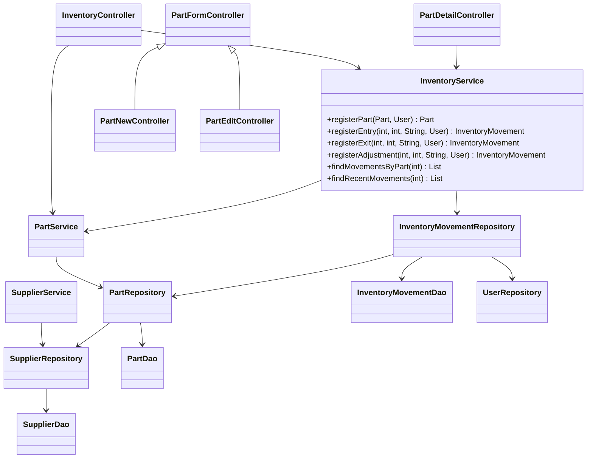

# Análisis — Módulo Inventario (Sprint 3, Desarrollador 1)

## Alcance
Lista de repuestos con indicadores (registrados, disponibles, stock bajo, agotados),
filtros por texto, categoría, estado de stock y proveedor; nuevo/editar repuesto;
detalle con historial de movimientos; entradas, salidas y ajustes de stock; alta
rápida de proveedores.

## Decisiones
- El stock **no se edita** en el formulario de edición: se cambia con un movimiento
  (`InventoryService`) para que quede en el historial con el usuario que lo hizo.
- Un repuesto nuevo con stock inicial deja una entrada «Stock inicial».
- El ajuste guarda la **diferencia** (la columna `quantity` exige `> 0`) y el motivo
  indica «de X a Y».
- El estado de stock lo calcula `Part` (Information Expert); el DAO no lo lee.
- `PartRepository` completa el proveedor con `SupplierRepository` (D-03, Indirection).

## Diagrama de clases

## Principios
Information Expert (stock en `Part`), Creator (`InventoryService` crea el movimiento),
Low Coupling (un Service usa otro Service), Indirection, SRP, DIP.
