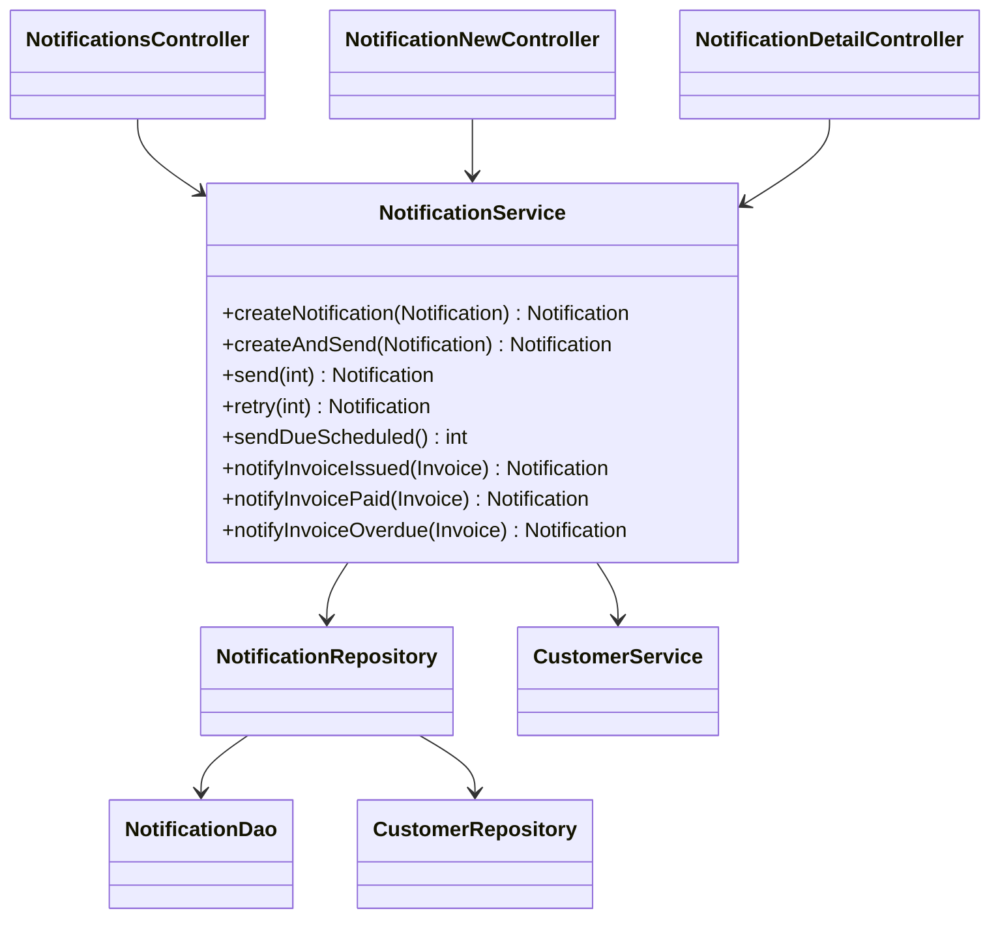

# Análisis — Notificaciones (Sprints 5 y 6, Desarrollador 1)

## Alcance
Sprint 5: `NotificationDao`, `NotificationRepository` y `NotificationService` (crear,
programar, enviar, reintentar, eliminar, consultar) y las notificaciones de
facturación (emitida, pagada, vencida) que usa el módulo de Facturación del Líder.
Sprint 6: historial con indicadores y filtros, nueva notificación y detalle.

## Decisiones
- **D-17:** todo el código de cada canal vive en `NotificationService.deliver`.
  EMAIL se simula (requiere correo del cliente), SYSTEM se marca enviada y WHATSAPP
  queda preparado sin integración (falla).
- Fecha futura → `SCHEDULED`; sin fecha o pasada → `PENDING` con la fecha actual.
  `sendDueScheduled()` envía las programadas que ya vencieron.
- Las promociones solo se crean si el cliente acepta promociones.
- Las notificaciones sí se pueden eliminar (no son documentos legales).

## Diagrama de clases

## Principios
Protected Variations (canales), Creator (notificaciones de factura), SRP, DIP, Low Coupling.
