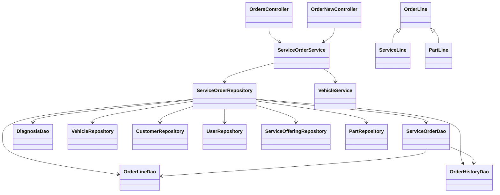

# Análisis — Órdenes de servicio: backend, lista y nueva orden (Sprint 4, Desarrollador 1)

## Alcance
`ServiceOrderService` (crear orden, armar líneas, buscar, consultar, contar),
lista de órdenes con indicadores, filtros y flujo de estados, y el formulario
«Nueva orden». El detalle, el cambio de estado, el historial posterior y el
descuento de stock los entrega el Líder.

## Decisiones
- **Transacción (D-09):** `ServiceOrderDao.createWithDetails` guarda cabecera, líneas
  e historial con una sola conexión; si algo falla hace `rollback`.
- Número de orden: consecutivo con 4 dígitos («0145»); en pantalla «#0145».
- Un vehículo no puede tener dos órdenes abiertas; al crear la orden pasa a `IN_SERVICE`
  y, si el kilometraje es mayor, se actualiza.
- El responsable es opcional; si se elige debe ser un `MECHANIC` activo (lo valida el Service).
- Las líneas toman el precio del catálogo/inventario; la de repuesto valida stock pero
  **no lo descuenta** (lo hace el Líder al avanzar la orden).
- `OrderLineDao`, `OrderHistoryDao` y `DiagnosisDao` no implementan `CrudOperations`
  porque sus filas no tienen id propio en el modelo (ISP).

## Diagrama de clases

## Principios
Creator (el Service crea la orden; la orden crea su historial), Information Expert
(totales en `ServiceOrder`), Polymorphism (`OrderLine.calculateTotal`), Low Coupling,
Protected Variations (el SQL y el `line_type` solo en `dao`).
