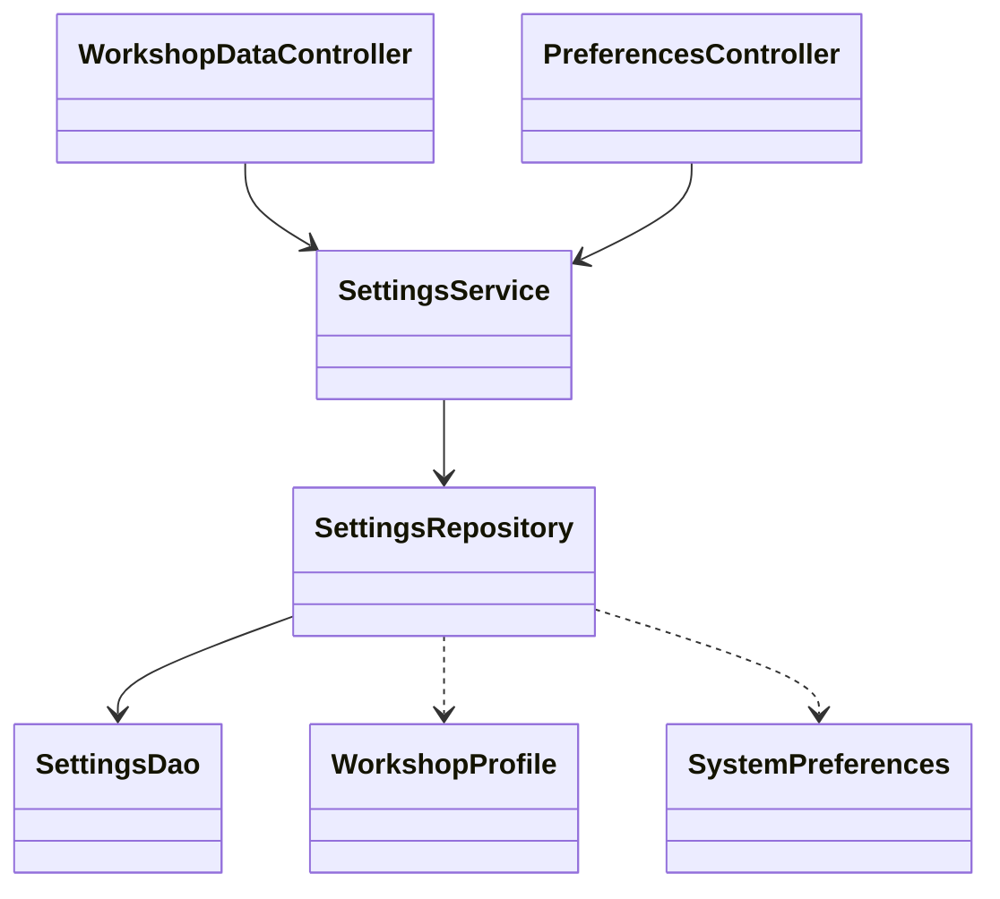

# Análisis — Datos del taller y Preferencias (Sprint 8, Desarrollador 1)

## Alcance
Modelos `WorkshopProfile` y `SystemPreferences`, tabla `app_settings`
(`docs/database/sprint8-settings.sql`), `SettingsDao`, `SettingsRepository`,
`SettingsService` y las pantallas «Datos del taller» y «Preferencias del sistema».
La pantalla general de Configuración y el resto de secciones son del Líder.

## Decisiones
- Tabla clave/valor: agregar un ajuste no exige cambiar el esquema. El Repository
  traduce las claves (`workshop.*`, `preferences.*`) a objetos del dominio.
- Si una clave no existe se usa el valor por defecto del modelo.
- El guardado es transaccional (`SettingsDao.saveAll`).
- Validaciones: nombre, NIT y correo obligatorios; registros por página 10/25/50/100;
  inactividad de 5 a 240 minutos cuando el cierre automático está activo.
- El logo del taller queda fuera del alcance de este sprint.

## Diagrama de clases

## Principios
Protected Variations (formato clave/valor oculto en el Repository), SRP, DIP, Information Expert.
