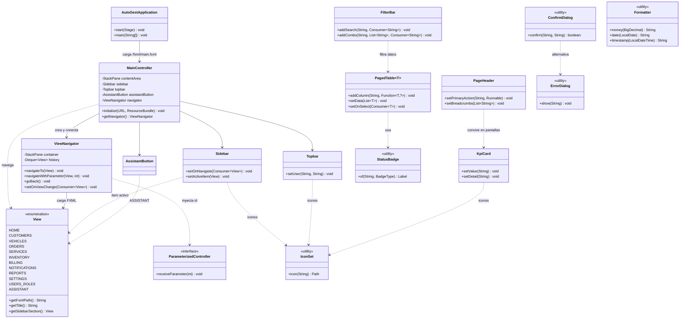

# Diagrama de clases - Navegación, componentes y sesión (Sprint 1)

Vista resumida de las clases de presentación de la base del Sprint 1. Se
centra en la navegación, los componentes reutilizables y el shell. `Session`,
`Permissions` y los servicios de usuario se completan en el Sprint 2.

## Notas de diseño

- **Indirection:** `ViewNavigator` es el único punto que cambia de pantalla;
  ninguna pantalla conoce a otra.
- **Pure Fabrication:** `Sidebar`, `Topbar`, `PagedTable`, `FilterBar`,
  `IconSet` y `Formatter` son clases de apoyo que mantienen limpias las
  pantallas y el modelo.
- **DIP / Low Coupling:** `Sidebar` y `ViewNavigator` se comunican por
  `Consumer`, no por referencias directas entre sí.
- **SRP:** cada componente hace una sola cosa; los diálogos y utilidades no
  contienen reglas de ningún módulo.
- En el Sprint 2 se agregan `Session`, `Permissions`, `AuthenticationService`,
  `UserService` y sus DAO/Repository en `AppContext`.
