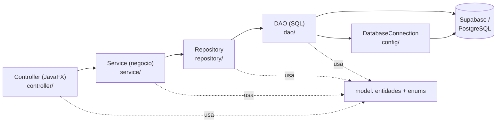
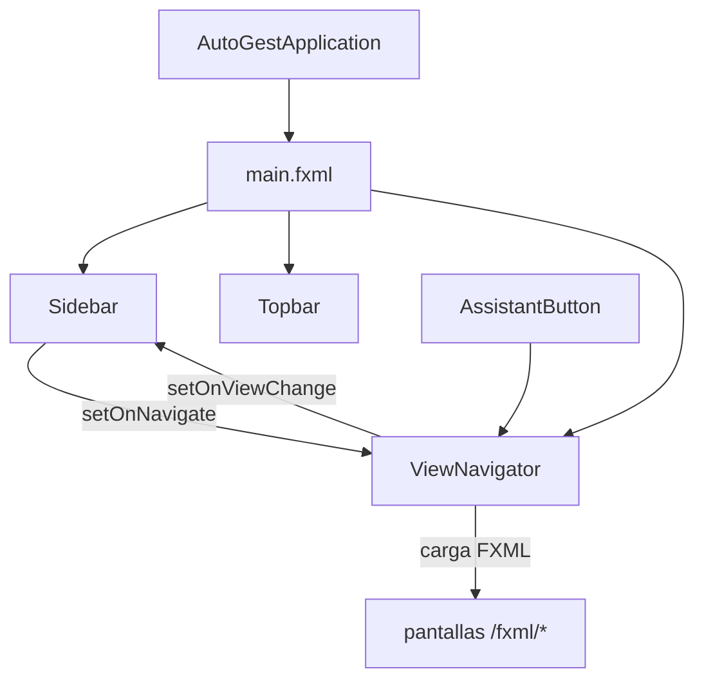

# Arquitectura de AutoGest

Documento de referencia de la **base de presentación** (Sprint 1). Explica cómo
se conectan las capas, qué contiene cada paquete y quién es dueño de cada
archivo. Complementa la guía de desarrollo del equipo.

## 1. Flujo entre capas

```
Controller  ->  Service  ->  Repository  ->  DAO  ->  Supabase / PostgreSQL
(JavaFX)        (negocio)    (acceso a        (acceso
                             datos)           tecnico)

model: entidades compartidas por todas las capas (no depende de ninguna)
```



Reglas de dependencia (nadie importa hacia arriba):

| Capa | Responsabilidad | Prohibido |
|---|---|---|
| Controller (`controller/`) | Maneja la interfaz JavaFX y traduce eventos en llamadas a los Services. Muestra errores al usuario. | Reglas de negocio, SQL, usar Repository o DAO. |
| Service (`service/`) | Lógica de negocio, validaciones y coordinación de casos de uso. | Importar `javafx.*` o `java.sql.*`. |
| Repository (`repository/`) | Organiza el acceso a datos y completa relaciones entre entidades. | Interfaz JavaFX, SQL directo. |
| DAO (`dao/`) | Operaciones SQL con `PreparedStatement`; convierte filas en entidades. | Reglas de negocio, `javafx.*`. |
| Model (`model/`) | Entidades, enumeraciones e interfaces del dominio. | Importar otras capas o hacer E/S. |

## 2. Estructura de paquetes y recursos

```
src/main/java/com/autogest
  AutoGestApplication.java
  config/        DatabaseConnection, AppContext
  controller/    MainController, View, ViewNavigator, ParameterizedController, Permissions
    components/  Sidebar, Topbar, PageHeader, KpiCard, StatusBadge,
                 PagedTable, FilterBar, ConfirmDialog, ErrorDialog,
                 AssistantButton, IconSet
    customer/ vehicle/ user/ ...   (un subpaquete por módulo)
  model/         entidades y enumeraciones
  service/       Services (lógica de negocio)
  repository/    Repositories
  dao/           DAOs + CrudOperations<T>
  exception/     excepciones propias
  util/          Formatter, PasswordHasher, Session

src/main/resources
  fxml/ (una carpeta por módulo)   css/ (css/fonts/)   images/   icons/
```

## 3. Navegación y shell

- `AutoGestApplication` abre la ventana (mínimo 1280x720), carga
  `/fxml/main.fxml` y aplica `autogest.css`.
- `main.fxml` arma el shell `BorderPane`: `Sidebar` a la izquierda, `Topbar`
  arriba, el área central (`StackPane`) y el botón flotante del Asistente.
- `MainController` crea el `ViewNavigator`, conecta la Sidebar (navegación), el
  navegador (resalta el ítem activo) y el botón del Asistente.
- `ViewNavigator` es el **único** que cambia de pantalla; carga el FXML de cada
  `View` y llama a `ParameterizedController.receiveParameter(id)` cuando la
  pantalla recibe un parámetro (detalle/edición).



Cada archivo FXML vive en `/fxml/<modulo>/<name>.fxml`; en el Sprint 1 las
pantallas de módulo son marcadores «En construcción» que cada dueño reemplaza
en su sprint.

## 4. Sistema de diseño

`css/autogest.css` define las variables (`-ag-navy`, `-ag-primary`, `-ag-bg`,
`-ag-card`, ...) y las clases globales (`.card`, `.page-title`, `.btn-primary`,
`.badge-*`, `.table-autogest`, ...). Ningún FXML ni clase Java fija colores.
Los íconos son `SVGPath` propios (`IconSet`, D-15), sin dependencias externas.
La fuente Roboto se incluye en `resources/css/fonts/` y se carga con
`Font.loadFont`; **[PENDIENTE]** los archivos `.ttf` aún no se agregaron.

## 5. Propiedad de archivos (evita conflictos de Git)

| Ruta | Dueño |
|---|---|
| `pom.xml`, `.gitignore`, `.gitattributes`, `README.md` | Líder |
| `AutoGestApplication`, `config/AppContext`, `css/autogest.css` | Líder |
| `controller/` (raíz), `controller/components/` | Líder |
| `controller/user/`, `fxml/user/`, `fxml/login.fxml`, `util/` | Líder |
| `service/AuthenticationService`, `UserService`; `repository/UserRepository`; `dao/UserDao` | Líder |
| `model/` (todo el paquete) | Desarrollador 1 |
| `controller/customer/`, `fxml/customer/`, `css/customers.css`, `service/CustomerService`, `repository/CustomerRepository`, `dao/CustomerDao` | Desarrollador 1 |
| `config/DatabaseConnection`, `exception/`, `dao/CrudOperations`, `docs/database/` | Desarrollador 2 |
| `controller/vehicle/`, `fxml/vehicle/`, `css/vehicles.css`, `service/VehicleService`, `repository/VehicleRepository`, `dao/VehicleDao` | Desarrollador 2 |
| `src/test/...` | Quien escribe la clase probada |
| `docs/analysis-<modulo>.md`, `docs/<modulo>-class-diagram.md` | Dueño del módulo |

## 6. Conexión de dependencias

`config/AppContext` es el **único** lugar donde se crean DAO, Repository y
Service (DIP, D-03). En el Sprint 1 solo está el esqueleto con los bloques
marcados por rol; cada integrante agrega su bloque en su sprint:

```
// ===== Customers (Dev 1) =====
// ===== Vehicles (Dev 2) =====
// ===== Users (Leader) =====
```

Los controladores piden sus Services con
`AppContext.getInstance().getXxxService()` (se agregan en el Sprint 2).
