# Diagrama de clases del módulo Clientes

**Autor:** Sebastián Murgas Tejeda (Desarrollador 1) · **Sprint 2** · AutoGest

El diagrama muestra las clases del módulo Clientes en el flujo
`Controller → Service → Repository → DAO`, y su relación con `Vehicle`.

```mermaid
classDiagram
    direction LR

    class CrudOperations~T~ {
        <<interface>>
        +create(T entity) T
        +findById(int id) T
        +findAll() List~T~
        +update(T entity) boolean
        +delete(int id) boolean
    }

    class Customer {
        -int id
        -DocumentType documentType
        -String documentNumber
        -String firstName
        -String lastName
        -String phone
        -String email
        -String city
        -String address
        -String notes
        -boolean acceptsPromotions
        -CustomerStatus status
        -LocalDate registrationDate
        +getFullName() String
        +isActive() boolean
        +deactivate() void
    }

    class CustomerStatus {
        <<enumeration>>
        ACTIVE
        INACTIVE
    }

    class DocumentType {
        <<enumeration>>
        CC
        CE
        NIT
        PASSPORT
    }

    class Vehicle {
        -int id
        -String licensePlate
        -Customer owner
        +getShortDescription() String
    }

    class CustomerService {
        -CustomerRepository repository
        +registerCustomer(Customer customer) Customer
        +updateCustomer(Customer customer) Customer
        +searchCustomers(String text, CustomerStatus status) List~Customer~
        +getDetail(int id) Customer
        +deactivateCustomer(int id) void
        +countCustomers() int
        +countActiveCustomers() int
        +countNewCustomersThisMonth() int
    }

    class CustomerRepository {
        -CustomerDao dao
        +create(Customer customer) Customer
        +findById(int id) Customer
        +findAll() List~Customer~
        +update(Customer customer) boolean
        +delete(int id) boolean
        +search(String text, CustomerStatus status) List~Customer~
        +existsByDocument(String number) boolean
        +existsByDocumentExcluding(String number, int id) boolean
        +count() int
        +countByStatus(CustomerStatus status) int
        +countRegisteredSince(LocalDate date) int
    }

    class CustomerDao {
        -DatabaseConnection connection
        +search(String text, CustomerStatus status) List~Customer~
        +existsByDocument(String number) boolean
        +existsByDocumentExcluding(String number, int id) boolean
        +count() int
        +countByStatus(CustomerStatus status) int
        +countRegisteredSince(LocalDate date) int
    }

    class CustomerListController {
        +setNavigator(ViewNavigator navigator) void
        +initialize(URL location, ResourceBundle resources) void
    }

    class CustomerFormController {
        +setNavigator(ViewNavigator navigator) void
        +initialize(URL location, ResourceBundle resources) void
        +receiveParameter(int parameter) void
    }

    class CustomerDetailController {
        +setNavigator(ViewNavigator navigator) void
        +receiveParameter(int parameter) void
    }

    class CustomerLabels {
        <<utility>>
        +statusText(CustomerStatus status) String
        +documentText(Customer customer) String
        +phoneText(String phone) String
        +initials(Customer customer) String
    }

    class AppContext {
        +getCustomerService() CustomerService
    }

    CustomerListController ..> CustomerService : usa
    CustomerFormController ..> CustomerService : usa
    CustomerDetailController ..> CustomerService : usa
    CustomerListController ..> CustomerLabels : textos
    CustomerFormController ..> CustomerLabels : textos
    CustomerDetailController ..> CustomerLabels : textos
    CustomerService --> CustomerRepository : depende de
    CustomerRepository --> CustomerDao : delega en
    CustomerDao ..|> CrudOperations : implementa
    CustomerDao ..> Customer : lee y escribe
    Customer --> CustomerStatus : status
    Customer --> DocumentType : documentType
    Vehicle "0..*" --> "1" Customer : owner
    AppContext ..> CustomerDao : crea
    AppContext ..> CustomerRepository : crea
    AppContext ..> CustomerService : crea
```

## Relaciones principales

| Relación | Descripción |
|---|---|
| `Customer` — `Vehicle` | Un cliente posee de cero a muchos vehículos (1 a 0..\*). El vehículo guarda a su propietario en `owner`. |
| `CustomerService` → `CustomerRepository` → `CustomerDao` | Dependencias solo hacia abajo. El Service nunca llama al DAO ni conoce SQL. |
| `CustomerDao` implementa `CrudOperations` | `delete` es una baja lógica: cambia el estado a `INACTIVE` (decisión D-02). |
| Controladores → `CustomerService` | Los tres controladores solo traducen eventos de pantalla en llamadas; no validan reglas. |
| `AppContext` crea `CustomerDao`, `CustomerRepository` y `CustomerService` | Es el único lugar que hace `new` de las tres clases (inversión de dependencias). |