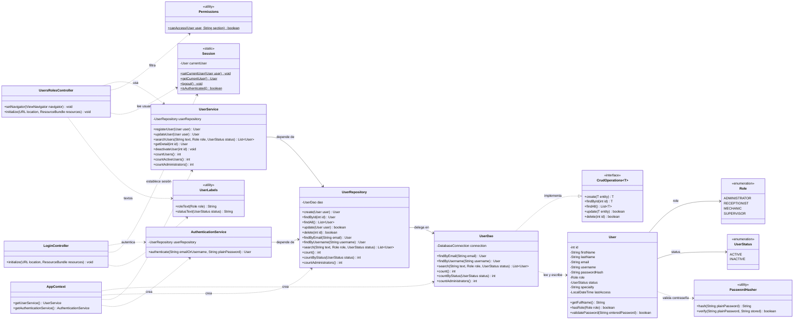

# Diagrama de clases del módulo Usuarios y Roles

**Autor:** Leonarth Steve Ali Camargo (Líder) · **Sprint 2** · AutoGest

El diagrama muestra las clases del módulo Usuarios/Roles en el flujo `Controller → Service → Repository → DAO`, junto a autenticación, sesión, permisos y su relación con `Role`/`UserStatus`.

## Relaciones principales

| Relación | Descripción |
|---|---|
| `User` — `Role` / `UserStatus` | El rol y el estado son atributos (sin jerarquía por rol). Los enums se almacenan como texto (`name()`). |
| `User.validatePassword()` → `PasswordHasher.verify()` | El hash PBKDF2-HMAC-SHA256, sal, iteraciones y comparación en tiempo constante viven fuera del modelo. |
| `AuthenticationService` vs `UserService` | Autenticación separada de gestión: `authenticate` valida credenciales/estado/actualiza `lastAccess`; `UserService` gestiona CRUD/búsqueda/conteos. |
| `Controller → Service → Repository → DAO` | Dependencias hacia abajo. Los controladores nunca acceden al DAO. |
| `Session` + `Permissions` | `Session` guarda el usuario autenticado; `Permissions` aplica la matriz por rol para filtrar la navegación (UI). |
| `UserDao` implementa `CrudOperations` | Acceso genérico; consultas específicas (`findByEmail`, `findByUsername`, conteos) se añaden aparte. |
| `AppContext` cablea las dependencias | Único lugar donde se crean `UserDao`, `UserRepository`, `UserService`, `AuthenticationService`. |
