# Diagrama de clases del módulo Vehículos

**Autor:** Leonarth Steve Ali Camargo (Líder) · **Sprint 2** · AutoGest

El diagrama muestra las clases del módulo Vehículos en el flujo `Controller → Service → Repository → DAO`, su relación con `Customer`, enums de dominio y componentes reutilizables.

```mermaid
classDiagram
    direction LR

    class CrudOperations~T~ {
        <<interface>>
        +create(T entity) T
        +findById(int id) T
        +findAll() List~T~
        +update(T entity) boolean
        +delete(int id) boolean
    }

    class VehicleStatus {
        <<enumeration>>
        ACTIVE
        IN_SERVICE
        INACTIVE
    }

    class VehicleType {
        <<enumeration>>
        CAR
        TRUCK
        MOTORCYCLE
        VAN
        OTHER
    }

    class FuelType {
        <<enumeration>>
        GASOLINE
        DIESEL
        GAS
        ELECTRIC
        HYBRID
    }

    class Transmission {
        <<enumeration>>
        MANUAL
        AUTOMATIC
    }

    class Customer {
        -int id
        -String firstName
        -String lastName
        +getFullName() String
    }

    class Vehicle {
        -int id
        -String make
        -String model
        -int year
        -String licensePlate
        -String vin
        -String color
        -FuelType fuelType
        -int mileage
        -VehicleStatus status
        -Customer owner
        -VehicleType vehicleType
        -Transmission transmission
        -String engineNumber
        -String registrationCardNumber
        -String observations
        -Integer lastMaintenanceMileage
        -LocalDate lastMaintenanceDate
        -Integer nextMaintenanceMileage
        -LocalDate nextMaintenanceDate
        +getShortDescription() String
        +isInService() boolean
        +updateMileage(int mileage) void
        +isMaintenanceDue(LocalDate today) boolean
    }

    class VehicleDao {
        -DatabaseConnection connection
        +search(String text, String make, VehicleStatus status, VehicleType type) List~Vehicle~
        +search(String text, VehicleStatus status, VehicleType type) List~Vehicle~
        +countByCustomer(int customerId) int
        +findMakes() List~String~
        +count() int
        +countByStatus(VehicleStatus status) int
    }

    class VehicleRepository {
        -VehicleDao dao
        +create(Vehicle vehicle) Vehicle
        +findById(int id) Vehicle
        +findAll() List~Vehicle~
        +update(Vehicle vehicle) boolean
        +delete(int id) boolean
        +search(String text, String make, VehicleStatus status) List~Vehicle~
        +search(String text, String make, VehicleStatus status, VehicleType type) List~Vehicle~
        +countByCustomer(int customerId) int
        +findMakes() List~String~
        +count() int
        +countByStatus(VehicleStatus status) int
    }

    class VehicleService {
        -VehicleRepository vehicleRepository
        -CustomerRepository customerRepository
        +registerVehicle(Vehicle vehicle) Vehicle
        +updateVehicle(Vehicle vehicle) Vehicle
        +getDetail(int id) Vehicle
        +findByCustomer(int customerId) List~Vehicle~
        +searchVehicles(String text, String make, VehicleStatus status) List~Vehicle~
        +searchVehicles(String text, String make, VehicleStatus status, VehicleType type) List~Vehicle~
        +searchVehiclesByType(String text, VehicleStatus status, VehicleType type) List~Vehicle~
        +findMakes() List~String~
        +updateMileage(int id, int mileage) void
        +deleteVehicle(int id) void
        +deactivateVehicle(int id) void
        +countVehicles() int
        +countActiveVehicles() int
        +countInService() int
        +countMaintenanceDue() int
        +countByCustomer(int customerId) int
    }

    class VehicleLabels {
        <<utility>>
        +statusText(VehicleStatus status) String
        +statusType(VehicleStatus status) String
        +typeText(VehicleType type) String
        +fuelText(FuelType type) String
        +transmissionText(Transmission transmission) String
        +maintenanceText(Vehicle vehicle) String
        +maintenanceType(Vehicle vehicle) String
        +mileage(Integer mileage) String
    }

    class VehiclesController {
        +setNavigator(ViewNavigator navigator) void
        +initialize(URL location, ResourceBundle resources) void
    }

    class VehicleFormController {
        <<abstract>>
        +setNavigator(ViewNavigator navigator) void
        +initialize(URL location, ResourceBundle resources) void
    }

    class VehicleNewController {
        #getRoot() VBox
        #isEditing() boolean
        #title() String
    }

    class VehicleEditController {
        #getRoot() VBox
        #isEditing() boolean
        #title() String
        +receiveParameter(int parameter) void
    }

    class VehicleDetailController {
        +setNavigator(ViewNavigator navigator) void
        +initialize(URL location, ResourceBundle resources) void
        +receiveParameter(int parameter) void
    }

    class PagedTable~T~ {
        <<component>>
        +setData(List~T~ data) void
        +setOnSelect(Consumer~T~ onSelect) void
    }

    class FilterBar {
        <<component>>
        +addSearch(String placeholder, Consumer~String~ onSearch) ComboBox
        +addCombo(String label, List~String~ options, Consumer~String~ onSelect) ComboBox
    }

    class AppContext {
        +getVehicleService() VehicleService
    }

    VehicleDao ..|> CrudOperations : implementa
    VehicleDao ..> Vehicle : lee y escribe
    VehicleRepository --> VehicleDao : delega en
    VehicleService --> VehicleRepository : depende de
    VehicleService --> CustomerRepository : usa para completar propietarios
    Vehicle --> VehicleStatus : status
    Vehicle --> VehicleType : vehicleType
    Vehicle --> FuelType : fuelType
    Vehicle --> Transmission : transmission
    Vehicle --> Customer : owner
    VehiclesController ..> VehicleService : usa
    VehiclesController ..> VehicleLabels : textos
    VehiclesController ..> PagedTable : tabla paginada
    VehiclesController ..> FilterBar : filtros
    VehicleFormController ..> VehicleService : guarda
    VehicleFormController ..> VehicleLabels : textos
    VehicleNewController --|> VehicleFormController
    VehicleEditController --|> VehicleFormController
    VehicleDetailController ..> VehicleService : usa
    VehicleDetailController ..> VehicleLabels : textos
    VehicleDetailController ..> PagedTable : otros vehículos
    AppContext ..> VehicleDao : crea
    AppContext ..> VehicleRepository : crea
    AppContext ..> VehicleService : crea
```

## Relaciones principales

| Relación | Descripción |
|---|---|
| `Vehicle` — `Customer` | Un cliente posee 0..* vehículos. `owner` guarda la referencia; los datos del propietario se obtienen desde `Customer`. |
| `VehicleService` → `VehicleRepository` → `VehicleDao` | Flujo por capas. `VehicleService` también usa `CustomerRepository` para completar/relacionar propietarios. |
| `VehicleDao` implementa `CrudOperations` | Operaciones genéricas + consultas específicas (`search` con marca/tipo/estado, `countByCustomer`, `findMakes`). |
| `deleteVehicle` = baja lógica | `VehicleService.deleteVehicle` delega en `deactivateVehicle` (D-02). No se elimina físicamente. |
| `isMaintenanceDue` es cálculo | «Mantenimiento próximo» se calcula con fecha de referencia (D-13), no es un campo guardado. |
| `searchVehicles` vs `searchVehiclesByType` | Para evitar ambigüedad entre sobrecargas con enums nulos se expone `searchVehiclesByType(text, status, type)`. |
| `VehiclesController` con guard `suppressReload` | Corrige el bucle infinito al actualizar el combo de marcas (`refreshMakes()` → `setValue()` dispara listener → `reload()`). |
| Componentes reutilizables | `PagedTable`, `FilterBar`, `PageHeader`, `KpiCard`, `StatusBadge` dan consistencia con el resto del sistema. |
| `AppContext` cablea dependencias | Crea `VehicleDao`, `VehicleRepository`, `VehicleService`. |
